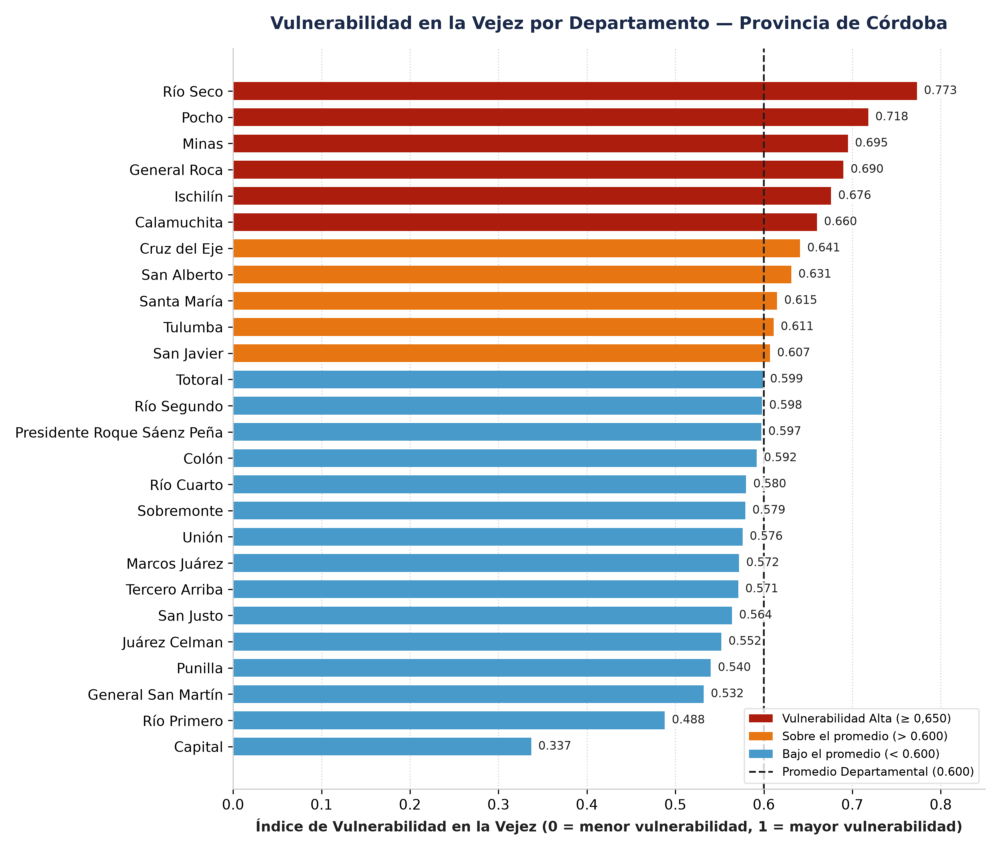
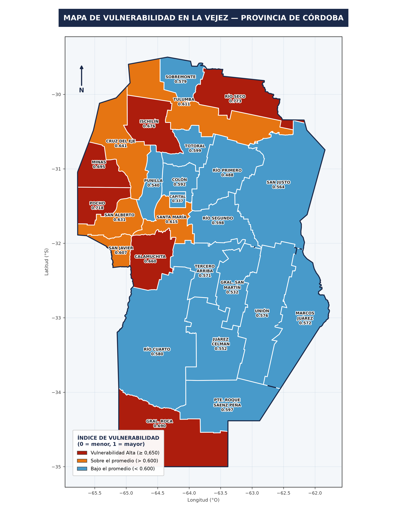
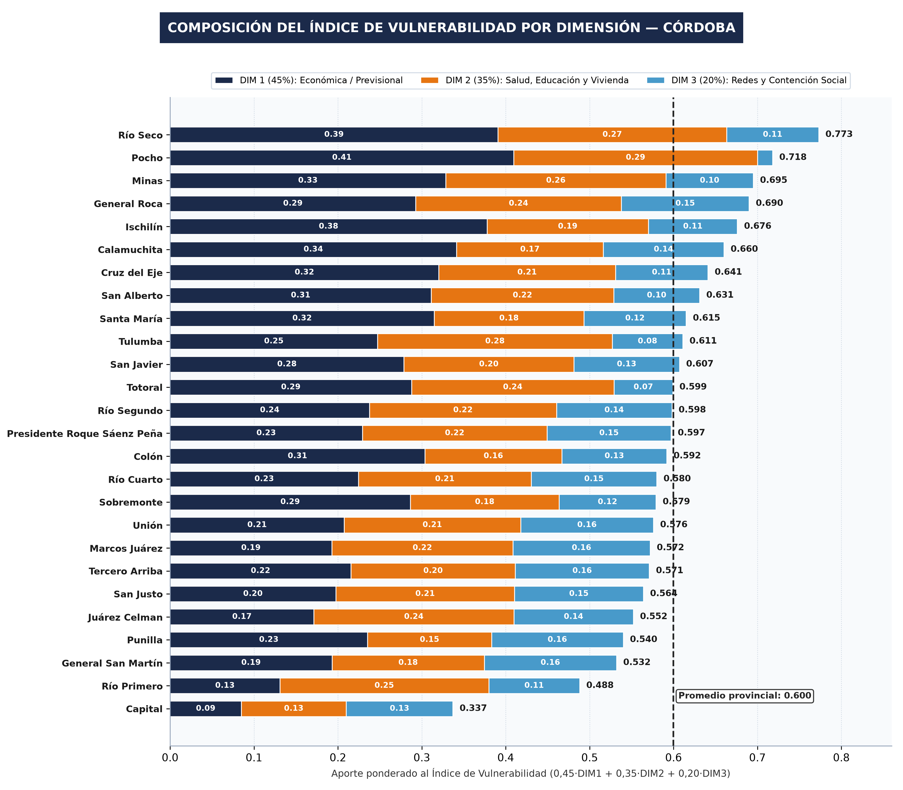
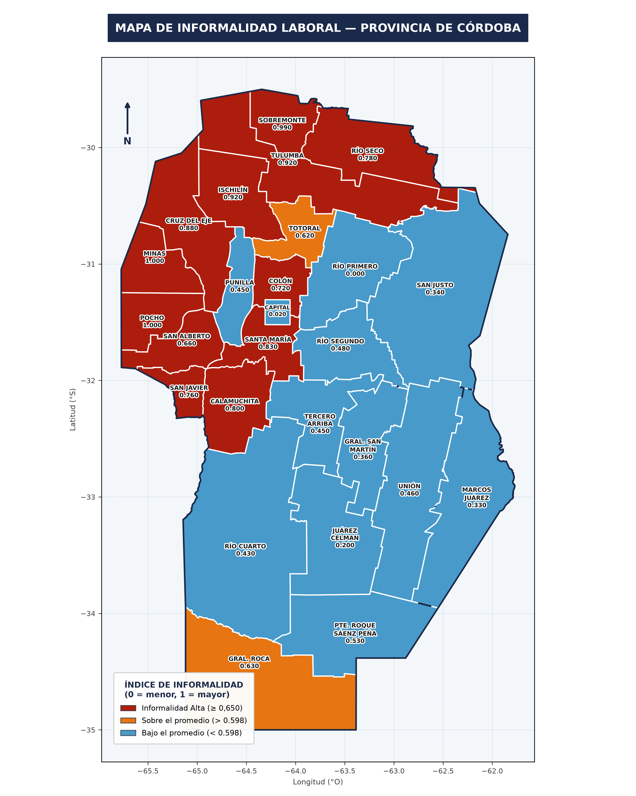

# Vulnerabilidad en la Vejez — Provincia de Córdoba

Proyecto de análisis territorial que estima la vulnerabilidad en la vejez en los
26 departamentos de la provincia de Córdoba. El trabajo combina indicadores
económicos, estructurales y sociales en un índice compuesto normalizado entre
0 y 1, donde **0 representa menor vulnerabilidad** y **1 mayor vulnerabilidad**.

Desarrollado por **Rodrigo Flores, Clara Galetto, Greta Meichtri Echenique,
Joaquin de la Colina, Alvaro Saguas Yazyi y Gaetano Milone**.

## Objetivos

- Comparar las condiciones de vulnerabilidad entre departamentos cordobeses.
- Construir tres dimensiones de análisis y un índice provincial compuesto.
- Identificar territorios con vulnerabilidad alta o por encima del promedio.
- Generar gráficos y mapas que faciliten la comunicación de los resultados.

## Metodología

El índice se construye a partir de tres dimensiones. Las variables se normalizan
en una escala comparable y luego se combinan mediante sumas ponderadas.

| Dimensión | Indicadores | Peso en el índice |
| :--- | :--- | ---: |
| DIM1 — Seguridad económica | Déficit monetario y tasa moratoria | 45 % |
| DIM2 — Bienestar estructural | Déficit de centros de salud, déficit educativo y déficit material | 35 % |
| DIM3 — Integración social | Déficit de centros de jubilados y nivel de contención familiar | 20 % |

El índice final se calcula como:

```text
INDICE_VUL = 0,45 × DIM1 + 0,35 × DIM2 + 0,20 × DIM3
```

Los pesos internos de cada dimensión son:

| Dimensión | Componentes y pesos |
| :--- | :--- |
| DIM1 | Déficit monetario 40 %; tasa moratoria 60 % |
| DIM2 | Déficit de centros de salud 35 %; déficit educativo 40 %; déficit material 25 % |
| DIM3 | Déficit de centros de jubilados 60 %; contención familiar 40 % |

Los scripts realizan los cálculos a partir de valores normalizados cargados dentro
del código. Los scripts de generación de dimensiones producen:

- `data/dim1_seguridad_economica.csv`
- `data/dim2_bienestar_estructural.csv`
- `data/dim3_integracion_social.csv`

El resultado global también se representa con categorías visuales:

- **Vulnerabilidad alta:** índice mayor o igual a 0,650.
- **Sobre el promedio:** índice mayor que el promedio departamental.
- **Bajo el promedio:** índice menor o igual al promedio departamental.

El promedio departamental calculado por el proyecto es aproximadamente
**0,586**.

> [!IMPORTANT]
> Los pesos y categorías son decisiones metodológicas del análisis. Las
> visualizaciones ayudan a comparar departamentos, pero no representan una
> valoración clínica o individual de las personas mayores.

## Resultados

### Índice por departamento



### Mapa de vulnerabilidad



### Composición del índice



### Informalidad



## Datos

Los archivos CSV generados contienen los indicadores normalizados y los índices
de cada dimensión por departamento.

| Archivo | Contenido |
| :--- | :--- |
| `data/dim1_seguridad_economica.csv` | DIM1 y sus dos indicadores |
| `data/dim2_bienestar_estructural.csv` | DIM2 y sus tres indicadores |
| `data/dim3_integracion_social.csv` | DIM3 y sus dos indicadores |
| `data/departamentos_cordoba.geojson` | Límites geográficos de los departamentos |

La procedencia original de los indicadores, el período analizado y el método
exacto de normalización deben verificarse y documentarse antes de publicar el
resultado como una fuente oficial.

## Estructura del repositorio

- `scripts/`: cálculo de dimensiones, índice y generación de gráficos y mapas.
- `data/`: indicadores resultantes y polígonos geográficos.
- `graph/`: visualizaciones generadas.
- `Makefile`: comandos de instalación y ejecución.
- `requirements.txt`: dependencias de Python.
- `README.md`: documentación del proyecto.

## Requisitos

- Python 3.
- PIP.
- Módulo estándar `venv`.
- GNU Make.

En sistemas basados en APT, las herramientas pueden instalarse con:

```bash
sudo apt update
sudo apt install python3-venv python3-pip make -y
```

## Configuración y ejecución

Crear el entorno virtual e instalar las dependencias:

```bash
make venv
make install
```

Calcular las tres dimensiones:

```bash
make dim1
make dim2
make dim3
```

Generar las visualizaciones:

```bash
make graph_vul
make map_vul
make map_informalidad
make apilado
```

## Lista de comandos

| Comando | Descripción |
| :--- | :--- |
| `make venv` | Crea el entorno virtual `.venv`. |
| `make install` | Crea el entorno virtual si no existe e instala `requirements.txt`. |
| `make dim1` | Ejecuta `scripts/ind_dim1.py` y genera DIM1. |
| `make dim2` | Ejecuta `scripts/ind_dim2.py` y genera DIM2. |
| `make dim3` | Ejecuta `scripts/ind_dim3.py` y genera DIM3. |
| `make graph_vul` | Genera el gráfico de vulnerabilidad por departamento. |
| `make map_vul` | Genera el mapa de vulnerabilidad departamental. |
| `make map_informalidad` | Genera el mapa de informalidad departamental. |
| `make apilado` | Genera el gráfico de composición ponderada del índice. |
| `make clean` | Elimina el entorno virtual `.venv`. |

> [!WARNING]
> `make clean` elimina el entorno virtual completo. Después de ejecutarlo,
> vuelve a correr `make install` antes de utilizar los scripts.

## Dependencias principales

Las dependencias usadas por el proyecto son:

- `numpy` y `pandas`: manipulación y cálculo de datos.
- `scipy` y `scikit-learn`: análisis estadístico y herramientas de ciencia de datos.
- `statsmodels`: modelos y estadística aplicada.
- `matplotlib` y `seaborn`: visualización.
- `geopandas`: lectura, unión y representación de datos geográficos.

## Limitaciones

- Los valores utilizados en los scripts deben conectarse con fuentes públicas,
  identificadas por indicador y período.
- El índice es territorial y no permite inferir la situación individual de una
  persona mayor.
- La escala 0–1 representa vulnerabilidad relativa en el conjunto analizado.
- Las categorías de vulnerabilidad son umbrales definidos por el trabajo y no
  estándares oficiales.
- La unión cartográfica depende de que los nombres de los departamentos coincidan
  entre los datos y el GeoJSON.